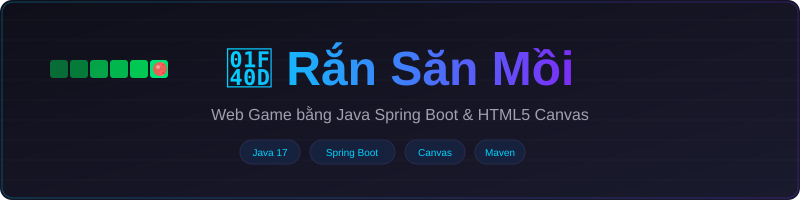
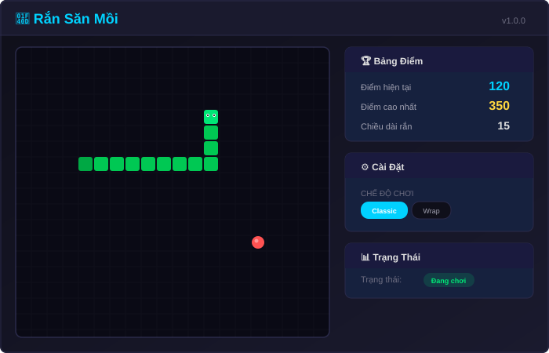
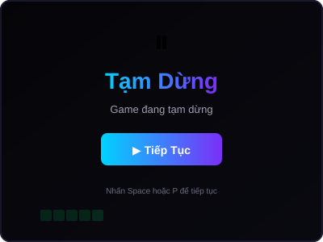
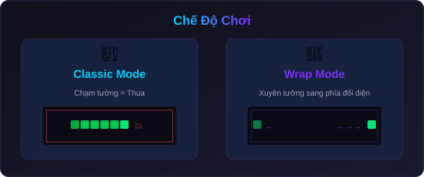
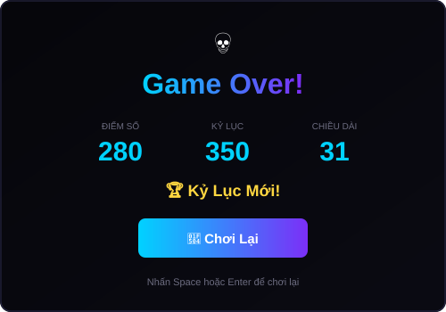
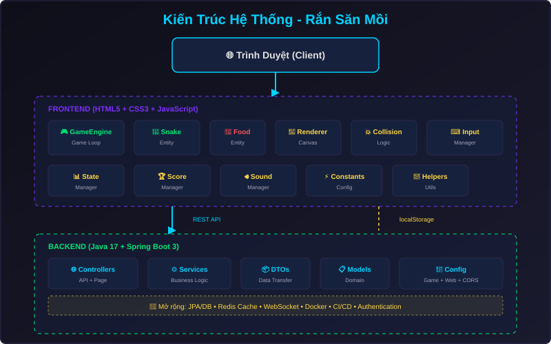

# 🐍 Rắn Săn Mồi - Web Game (Java Spring Boot)



Một phiên bản hiện đại, chuyên nghiệp của tựa game kinh điển **Rắn Săn Mồi (Snake Game)**. Dự án được xây dựng với kiến trúc Client-Server sử dụng **Java 17**, **Spring Boot 3** ở backend và thuần **HTML5 Canvas / CSS3 / JavaScript** ở frontend.

Trò chơi được thiết kế hướng tới khả năng mở rộng (scale-friendly), cấu trúc module hóa rõ ràng, dễ dàng bảo trì và bổ sung các tính năng nâng cao như Multiplayer, Leaderboard trực tuyến, hệ thống tài khoản người chơi trong tương lai.

## 📑 Mục lục

- [Demo / Tổng quan tính năng](#-demo--tổng-quan-tính-năng)
- [Ảnh chụp màn hình](#-ảnh-chụp-màn-hình)
- [Công nghệ sử dụng](#-công-nghệ-sử-dụng)
- [Kiến trúc hệ thống](#-kiến-trúc-hệ-thống)
- [Cây thư mục](#-cây-thư-mục)
- [Cài đặt & Chạy Local](#-cài-đặt--chạy-local)
- [Hướng dẫn sử dụng & Luật chơi](#-hướng-dẫn-sử-dụng--luật-chơi)
- [Phân tích kỹ thuật chuyên sâu](#-phân-tích-kỹ-thuật-chuyên-sâu)
- [API Reference](#-api-reference)
- [Hướng dẫn tùy biến](#-hướng-dẫn-tùy-biến)
- [Lộ trình phát triển (Roadmap)](#-lộ-trình-phát-triển-roadmap)
- [FAQ / Troubleshooting](#-faq--troubleshooting)
- [Thông tin tác giả](#-thông-tin-tác-giả)
- [License](#-license)

---

## 🎮 Demo / Tổng quan tính năng

Trò chơi sở hữu giao diện hiện đại, chế độ chơi đa dạng và hệ thống quản lý mượt mà.

### Các tính năng cốt lõi:

- **Gameplay ổn định:** Render mượt mà bằng HTML5 Canvas với Game Loop tự động tối ưu tốc độ.
- **Chế độ chơi (Game Modes):**
  - _Classic:_ Chạm tường là thua (Truyền thống).
  - _Wrap (Xuyên tường):_ Rắn đi qua tường sẽ xuất hiện ở phía đối diện.
- **Hệ thống Độ khó (Difficulty):** Dễ (Easy), Bình thường (Normal), Khó (Hard) – Ảnh hưởng đến tốc độ di chuyển và thuật toán tính điểm.
- **Lưu điểm cao (High Score):**
  - Lưu cục bộ với LocalStorage.
  - Sẵn sàng tích hợp API lưu điểm lên Server (Đã triển khai Backend Endpoints).
- **Tùy biến Giao diện (Themes):** Hỗ trợ Dark, Light và Retro (Màn hình xanh cổ điển).
- **Hiệu ứng & Âm thanh:** Âm thanh sinh động khi ăn mồi, thua cuộc và các hiệu ứng Particles đơn giản.
- **Điều khiển đa dạng:** Hỗ trợ phím mũi tên (Arrow keys) và cụm phím WASD.
- **Responsive:** Chơi mượt mà trên Desktop, thiết kế không vỡ layout trên Tablet/Mobile (cần thêm on-screen gamepad cho mobile ở phiên bản sau).

---

## 📸 Ảnh chụp màn hình

|               Gameplay                |               Màn hình Tạm dừng               |
| :-----------------------------------: | :-------------------------------------------: |
|  |  |

|         Các Chế độ chơi         |                Game Over                |
| :-----------------------------: | :-------------------------------------: |
|  |  |

---

## 🛠 Công nghệ sử dụng

### Backend (Server-side)

- **Ngôn ngữ:** Java 17+
- **Framework chính:** Spring Boot 3.x (Spring Web, Spring Boot Starter Thymeleaf)
- **Build Tool:** Maven
- **Kiến trúc:** RESTful API kết hợp Server-Side Rendering (Thymeleaf) cho trang chủ.
- **Lưu trữ:** Cấu trúc sẵn sàng tích hợp Spring Data JPA / H2 Database hoặc PostgreSQL.

### Frontend (Client-side)

- **Cốt lõi:** HTML5, CSS3, JavaScript (ES6+) thuần (Vanilla JS), không phụ thuộc thư viện nặng.
- **Đồ họa:** HTML5 Canvas API (Tối ưu hiệu suất vẽ 2D).
- **Kiến trúc JS:** Module Pattern, OOP (Lập trình hướng đối tượng), State Management.

---

## 🏗 Kiến trúc hệ thống



Dự án được thiết kế theo nguyên tắc **Separation of Concerns (SoC)**, tách biệt rõ ràng giữa Backend (Phục vụ file tĩnh, cấp cấu hình, quản lý điểm số) và Frontend (Xử lý toàn bộ logic Game Loop, Render, Input).

### Vai trò các thành phần:

1.  **Spring Boot Application:** Cung cấp HTTP Server, phục vụ file tĩnh (HTML/CSS/JS) và expose REST APIs `/api/v1/*`.
2.  **JS Game Engine:** Điều phối toàn bộ hoạt động bên trong Canvas. Gồm các thành phần: `Renderer`, `InputManager`, `StateManager`, và các Game Entities (`Snake`, `Food`).
3.  **Local Storage / API Sync:** Hệ thống lưu điểm số. Frontend tự động đồng bộ điểm cao mới nhất lên Backend thông qua REST API.

---

## 📂 Cây thư mục

```text
snake-game/
├── docs/                        # Tài liệu và hình ảnh cho README
│   └── images/                  # (banner.svg, gameplay.svg, architecture.svg...)
├── src/
│   └── main/
│       ├── java/com/snakegame/
│       │   ├── SnakeWebApplication.java     # Entry point Spring Boot
│       │   ├── config/                      # Cấu hình CORS, WebMvc, Global Config
│       │   ├── controller/                  # REST APIs và View Controllers
│       │   ├── dto/                         # Data Transfer Objects
│       │   ├── exception/                   # Xử lý lỗi tập trung (GlobalExceptionHandler)
│       │   ├── model/                       # Entities (VD: HighScore)
│       │   └── service/                     # Business Logic (VD: HighScoreService)
│       └── resources/
│           ├── application.properties       # Cấu hình Spring Boot (Port, Logging...)
│           ├── static/                      # Static assets
│           │   ├── css/style.css            # Styling giao diện
│           │   ├── images/favicon.svg       # Icon
│           │   └── js/                      # Frontend JavaScript
│           │       ├── app.js               # Entry file, khởi tạo GameEngine
│           │       ├── core/                # Core logic (engine, renderer, constants)
│           │       ├── entities/            # Các thực thể game (snake.js, food.js)
│           │       ├── managers/            # Quản lý trạng thái, âm thanh, điểm số
│           │       └── utils/               # Các hàm tiện ích
│           └── templates/
│               └── index.html               # Thymeleaf Template chính
├── .gitignore                   # Ignore file của Git
├── LICENSE                      # Giấy phép (MIT)
├── pom.xml                      # Cấu hình Maven (Dependencies)
└── README.md                    # Tài liệu hướng dẫn
```

---

## 🚀 Cài đặt & Chạy Local

### Yêu cầu môi trường

- **Java Development Kit (JDK):** Phiên bản 17 hoặc mới hơn.
- **Maven:** Đã cài đặt và có trong System PATH (để build code).
- **Trình duyệt Web:** Google Chrome, Firefox, Edge, Safari phiên bản mới.

### Hướng dẫn từng bước

**Bước 1: Clone repository**

```bash
git clone <REPO_URL>
cd snake-game
```

**Bước 2: Build dự án**
Sử dụng Maven để tải dependencies và đóng gói dự án:

```bash
mvn clean install
```

_(Lưu ý: Nếu không muốn chạy test trong quá trình build, có thể thêm flag `-DskipTests`)_

**Bước 3: Chạy ứng dụng**
Khởi động Spring Boot server:

```bash
mvn spring-boot:run
```

Hoặc chạy file JAR đã được build:

```bash
java -jar target/snake-game-1.0.0.jar
```

**Bước 4: Trải nghiệm**
Mở trình duyệt và truy cập:
👉 **[http://localhost:8080](http://localhost:8080)**

---

## 🎮 Hướng dẫn sử dụng & Luật chơi

### Luật chơi cơ bản

- Sử dụng phím điều hướng để di chuyển Rắn.
- Ăn "Mồi" (các đốm màu đỏ) để ghi điểm và làm Rắn dài ra.
- Mỗi lần ăn mồi, tốc độ di chuyển sẽ tăng nhẹ (tuỳ thuộc vào độ khó).
- **Bạn sẽ thua (Game Over) nếu:**
  - Đầu rắn đâm vào thân của chính nó.
  - Đầu rắn đâm vào tường chắn (Nếu đang chơi chế độ _Classic_).

### Phím tắt điều khiển (Controls)

| Phím / Cụm phím         | Hành động                          |
| :---------------------- | :--------------------------------- |
| `↑` hoặc `W`            | Di chuyển lên trên                 |
| `↓` hoặc `S`            | Di chuyển xuống dưới               |
| `←` hoặc `A`            | Di chuyển sang trái                |
| `→` hoặc `D`            | Di chuyển sang phải                |
| `Space` / `Enter` / `P` | Bắt đầu / Tạm dừng / Tiếp tục game |
| `M`                     | Bật / Tắt âm thanh (Mute)          |

### Các Chế độ chơi (Modes)

1.  **Classic (Kinh điển):** Không gian chơi là một hộp kín. Đâm vào viền Canvas là chết.
2.  **Wrap (Xuyên tường):** Không gian vô tận. Khi rắn đi ra khỏi rìa phải màn hình, nó sẽ xuất hiện lại ở rìa trái (và ngược lại với các chiều khác).

---

## ⚙️ Phân tích kỹ thuật chuyên sâu

### 1. Luồng hoạt động của Game (Game Loop)

Game sử dụng `setInterval` (hoặc `requestAnimationFrame`) làm nhịp tim (Heartbeat) của hệ thống, quản lý bởi `game-engine.js`.
Tốc độ (Interval) được nội suy dựa trên độ khó và số điểm hiện tại.

Mỗi _Tick_ (một chu kỳ vòng lặp), hệ thống thực hiện theo thứ tự:

1.  **Tính toán hướng đi (Input):** Lấy hướng di chuyển mới nhất từ `InputManager`. Ngăn chặn việc quay đầu 180 độ trái logic (VD: Đang đi lên thì không thể đi thẳng xuống).
2.  **Di chuyển (Update State):** Cập nhật tọa độ đầu rắn, đẩy các đốt thân đi theo.
3.  **Kiểm tra va chạm (Collision Detection):**
    - Kiểm tra va chạm tường (dựa theo Mode).
    - Kiểm tra va chạm thân mình.
    - Kiểm tra va chạm mồi.
4.  **Xử lý Logic:** Sinh mồi mới, cộng điểm, tăng tốc nếu ăn mồi. Dừng loop nếu Game Over.
5.  **Render (Vẽ):** Xóa toàn bộ Canvas và vẽ lại Rắn, Mồi, Lưới dựa trên dữ liệu State mới.

### 2. Thuật toán xử lý di chuyển của Rắn

Rắn được biểu diễn bằng một mảng các tọa độ `{x, y}`.
Khi rắn di chuyển một ô:

- Tính toán tọa độ phần Đầu Mới (New Head) dựa trên Đầu Cũ và Hướng hiện tại.
- `unshift()` Đầu Mới vào đầu mảng.
- Nếu không ăn mồi, `pop()` phần Đuôi (phần tử cuối mảng) ra khỏi mảng. Nếu ăn mồi, giữ nguyên (rắn dài ra 1 ô).

### 3. Xử lý lưu Điểm Cao (High Score)

- **Cấp độ Client:** Sử dụng `localStorage` lưu trữ dưới dạng JSON, cấu trúc theo Key: `snake_highscore_<mode>_<difficulty>`.
- **Cấp độ Server:** Khi kết thúc game, nếu có kỷ lục mới, Frontend bắn HTTP POST request mang Payload `HighScoreRequest` lên endpoint `/api/v1/scores`. Backend validate và lưu trữ (hiện tại lưu In-Memory List, sẵn sàng thay thế bằng DB Repo).

---

## 📡 API Reference

Dự án expose các REST API để mở rộng tính năng.

### 1. Lấy thông tin cấu hình Game

- **Endpoint:** `GET /api/v1/game/config`
- **Mô tả:** Lấy thông số kỹ thuật (Canvas size, tốc độ mặc định) từ Backend để đồng bộ Client.
- **Response (200 OK):**

```json
{
  "canvasSize": 400,
  "gridSize": 20,
  "speeds": {
    "EASY": 180,
    "NORMAL": 140,
    "HARD": 90
  }
}
```

### 2. Gửi Điểm cao (Submit High Score)

- **Endpoint:** `POST /api/v1/scores`
- **Mô tả:** Lưu lại thành tích của người chơi.
- **Payload:**

```json
{
  "playerName": "Người chơi",
  "score": 150,
  "mode": "classic",
  "difficulty": "normal"
}
```

---

## 🎨 Hướng dẫn tùy biến

Để thay đổi thông số game, bạn chỉ cần điều chỉnh tại một file duy nhất: `src/main/resources/static/js/core/constants.js`.

- **Đổi kích thước bàn chơi:** Sửa `CANVAS_SIZE` (Khuyến nghị 400, 500, 600) và `GRID_SIZE`.
- **Chỉnh độ khó/Tốc độ:** Thay đổi giá trị mili-giây trong object `SPEED`. Số càng nhỏ, rắn chạy càng nhanh.
- **Sửa màu sắc giao diện:** Sửa các mã Hex code trong `SNAKE_COLORS` và `FOOD_COLORS`.

```javascript
// Ví dụ: Làm rắn chạy siêu nhanh ở mức Hard
const GAME_CONFIG = {
  // ...
  SPEED: {
    EASY: 200,
    NORMAL: 120,
    HARD: 50, // Giảm từ 90 xuống 50
  },
};
```

---

## 🔮 Lộ trình phát triển (Roadmap)

Kiến trúc dự án được thiết kế để dễ dàng thêm các tính năng sau:

- [ ] **Tích hợp Database thực tế:** Thêm PostgreSQL/MySQL qua Spring Data JPA để lưu HighScore vĩnh viễn.
- [ ] **Leaderboard toàn cầu:** Tạo màn hình xếp hạng top 100 người chơi.
- [ ] **Authentication:** Đăng nhập, lưu lịch sử chơi cá nhân (Spring Security + JWT).
- [ ] **Multiplayer (Realtime):** Hai con rắn cùng thi đấu trên 1 máy, hoặc qua mạng bằng WebSockets / STOMP.
- [ ] **Vật phẩm đặc biệt (Power-ups):** Thêm mồi vàng (nhiều điểm), mồi đóng băng (giảm tốc độ).
- [ ] **Dockerization:** Đóng gói ứng dụng thành Docker Image.

---

## ❓ FAQ / Troubleshooting

**Q: Cổng 8080 trên máy tôi đã bị chiếm dụng, làm sao để đổi cổng?**

> A: Mở file `src/main/resources/application.properties`, đổi `server.port=8080` thành cổng khác (ví dụ: `8081`).

**Q: Khi tôi bấm các phím mũi tên, cả trang web bị cuộn lên xuống?**

> A: Mã nguồn JS đã chặn hành vi mặc định của phím mũi tên (`e.preventDefault()`). Tuy nhiên nếu bạn thấy lỗi này, hãy chắc chắn click chuột vào khu vực chơi (Canvas) để focus trước khi ấn phím.

**Q: Làm sao để thay đổi âm thanh?**

> A: Bạn có thể đặt file âm thanh của mình vào `src/main/resources/static/sounds/` (VD: eat.mp3, dead.mp3) và khởi tạo chúng bằng lớp `Audio` trong file `sound-manager.js`.

---

## 👨‍💻 Thông tin tác giả

- **Kiến trúc sư / Kỹ sư phần mềm:** [Tên của bạn / Nickname]
- **Vai trò:** Principal Software Engineer & Game Architect
- **Liên hệ / Portfolio:** [Link tới GitHub/LinkedIn của bạn]

---

## 📄 License

Dự án này được phân phối dưới giấy phép **MIT License**. Bạn hoàn toàn tự do sử dụng, chỉnh sửa, phân phối và sử dụng cho mục đích thương mại. Chi tiết xem tại file `LICENSE`.

---

_Được thiết kế với ❤️ và đam mê công nghệ._
